<h1>Hi, I'm Akshita Pardeshi 👋</h1>

<strong>Computer Science & Engineering student · Backend and Flutter developer · Nagpur, India</strong>

I build dependable backend services and thoughtful mobile experiences, with a growing interest in cloud computing, distributed systems, and machine learning.

<a href="https://github.com/akshitap30">GitHub</a> · <a href="https://www.linkedin.com/in/akshita-pardeshi-b8aa2732b">LinkedIn</a> · <a href="https://leetcode.com/u/xrN35gOFFE/">LeetCode</a> · <a href="mailto:akshitapardeshi2006@gmail.com">Email</a>

<h2>✦ About me</h2>
<ul>
<li>🎓 B.Tech in Computer Science and Engineering at Ramdeobaba University (RCOEM), 2024–2028 · CGPA: 9.19/10</li>
<li>☁️ Infosys Springboard Virtual Internship · Remote · Oct 2026–Present</li>
<li>⚙️ Focused on Java backend engineering, cloud systems, and useful end-to-end products</li>
</ul>
<h2>✦ Featured projects</h2>
<table>
<tr><td width="50%" valign="top"><h3><a href="https://github.com/akshitap30/ExpenseTracker">💳 ExpenseTracker</a></h3>
Secure expense management REST API with Spring Boot, Java, PostgreSQL, JWT authentication, receipt upload, search, filtering, and pagination. Docker Compose runs the full stack locally.

Java · Spring Boot · PostgreSQL · JWT · Docker
</td><td width="50%" valign="top"><h3><a href="https://github.com/akshitap30/MoodSpend">📱 MoodSpend</a></h3>
Flutter app connecting moods and spending habits, with Supabase authentication and realtime data plus Hive-backed offline-first logging.

Flutter · Dart · Supabase · Hive · Riverpod · FL Chart
</td></tr>
</table>
<h2>✦ Experience</h2>

<strong>Infosys Springboard Virtual Internship</strong> · Remote · Oct 2026–Present Taking part in a remote virtual internship program on the Infosys Springboard platform.

<strong>JPMorgan Chase Software Engineering Job Simulation</strong> · Forage · May 2026 Built a Spring Boot service that consumes Kafka transactions, persists data with Spring Data JPA and H2, integrates an external REST incentive API, and is verified with Maven tests.

<h2>✦ Tech stack</h2>

Skill icons are provided by <a href="https://github.com/tandpfun/skill-icons">Skill Icons</a>, an MIT-licensed open-source project.

<h2>✦ Highlights</h2>
<ul>
<li>🏆 Placed 4th at the Women in Dev Hackathon at IIIT Nagpur, among the top 10 teams</li>
<li>🤝 Helped manage crowd flow for 1,000+ attendees at Polaris 2026 (Compusys)</li>
<li>🧠 Completed NVIDIA Deep Learning Institute’s Fundamentals of Deep Learning course</li>
</ul>
<h2>✦ Contribution garden</h2>

Updated daily by GitHub Actions · <a href="https://github.com/akshitap30?tab=repositories">Explore all repositories</a> · Open to collaboration and meaningful engineering challenges.

